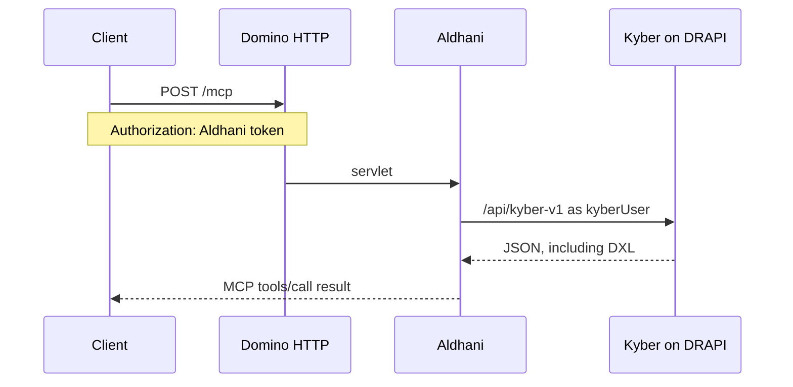

# Aldhani - Infoware MCP server for HCL Domino design

An MCP server for an AI agent that creates, reads, updates, and deletes Domino design through Kyber.

Aldhani is an MCP server for HCL Domino design. It runs as an OSGi servlet on the Domino HTTP task and answers MCP at `POST /mcp`. Every design call is a Kyber call on DRAPI. Kyber remains the API that changes design. Writes are off unless `allowWrite` is true.

Version 0.1.3. It is an Infoware Solutions Svenska AB product and is published under [Apache-2.0](LICENSE). The sandbox database is `aldhanitest.nsf`. Kyber only lists a database whose catalog category is `KyberEnabled`.

## Purpose

An agent needs to work with Domino design through the products Infoware already runs. The agent speaks MCP. Domino is where that endpoint lives, because Domino is the product being worked on and the servlet installs on another Domino server the same way Kyber's jar does. Kyber on DRAPI is the design API, and it stays the only component that creates or updates a design element.

Aldhani translates MCP into Kyber calls and limits which NSF files the agent may ask about. DRAPI can stay on the server. The agent reaches `/mcp` on the HTTP task. `kyberUser` is the identity Kyber sees, for reads and for writes. Database delete, a full design import, and an ACL replacement are not tools.

## How a call moves



Two checks happen on every call.

1. The servlet compares the caller token with `bearerToken` in `aldhani.json`.
2. The servlet logs in to Kyber with `kyberUser` and `kyberPassword`, then sends Kyber's bearer on the design request.

The allowlist is applied before Kyber is called. A path that contains `..`, starts with `/`, or contains `:` is rejected. When `allowedNsf` has one entry, `nsfPath` may be omitted and that entry is used. `list_databases` asks Kyber for databases and then keeps only allowlist names. Names on the allowlist that Kyber did not return are listed under `missing`.

## What this version leaves to Kyber

With `allowWrite` false, Aldhani only reads. With `allowWrite` true, `create_design`, `update_design`, `delete_design`, and `validate_design` call the matching Kyber route. `validate_design` writes nothing. Database delete, a full design import, and replacing the ACL stay in Kyber and are not tools.

A tool result is text. A body over 100 000 characters is returned as JSON with `truncated` and `chars`, plus `name` and `unid` when the payload has them. The DXL is left out, so the result is never cut in the middle of a string. `list_design` takes an optional `limit` and keeps the first rows. Prefer that, then `get_design` for one element.

## Requirements

- Domino HTTP task with the Equinox servlet registry (`javax.servlet` 2.4 or 2.5, the `com.ibm.pvc.servlet` bundle)
- Java 21
- Kyber installed on DRAPI, reachable from the HTTP task
- JDK 21 on the build machine. `build.ps1` uses `C:\Domino\jvm` when that JVM has `java`, and `javac` from `PATH` when the Domino JVM has no compiler

DRAPI's data port can stay unpublished. Aldhani calls it from the same machine. The example configuration uses `https://dantooine.oninfoware.local:8880` and trusts that certificate (`insecureTls`).

## Build

```powershell
.\build.ps1
```

The build compiles the servlet, runs `AldhaniSelfTest` in process, and writes `target\infoware-aldhani-0.1.3.jar`. That jar is the OSGi plugin. `feature.xml` is packed inside it for `install.ps1`. The self-test does not call Domino or Kyber.

`target\` is gitignored.

## Install

The HTTP task loads the feature only when it is listed in `platform.xml`. The applications site on Domino uses the `USER-EXCLUDE` policy, and Equinox reads the feature as a directory, so copying a jar into `plugins` is not enough. `install.ps1` does three things:

- copies the plugin to `plugins\se.infoware.domino.aldhani_0.1.3.jar`
- unpacks `feature.xml` to `features\se.infoware.domino.aldhani.feature_0.1.3\`
- adds the feature under the applications site in `domino\workspace\.config\org.eclipse.update\platform.xml`

Stop HTTP first. On shutdown the HTTP task rewrites `platform.xml` from memory, so an edit made while HTTP is running is lost. `tell http restart` does not reload this configuration.

```text
tell http quit
.\install.ps1 -DataDir <Domino data>
load http
```

`install.ps1` refuses to run when `nhttp` is running and `<Domino data>\notes.ini` exists. Leave the Windows service running. Restart only the HTTP task.

`-Jar` defaults to the single `target\infoware-aldhani-*.jar` from the build.

A new jar is picked up on the next HTTP start. `aldhani.json` is read again when its modification time changes, without an HTTP restart.

## Configuration

Copy `aldhani.json.example` to `<Domino data>\aldhani.json`. `ALDHANI_CONFIG` can point at another file. The example file's `_comment` key is ignored.

| Field | Meaning |
| --- | --- |
| `kyberBaseUrl` | DRAPI data URL, without a trailing slash. |
| `kyberUser` | Domino name Aldhani sends to `POST /api/v1/auth`. |
| `kyberPassword` | Password for that name. |
| `bearerToken` | Token the MCP client must send. |
| `allowedNsf` | NSF paths Kyber may be asked about. At least one. |
| `insecureTls` | Trust DRAPI's certificate and skip hostname checks. Use this for a private certificate on the same server. |
| `allowWrite` | When true, list the four write tools. Missing or false keeps an existing install read-only. |

`aldhani.json`, `.env`, and `.cursor/mcp.json` hold passwords and tokens. They are gitignored.

## Call the endpoint

`POST /mcp` with `Content-Type: application/json` and an `Accept` of `application/json`, `text/event-stream`, or `*/*`. `GET` returns 405. The server is stateless. A notification, a request with no `id`, returns 202 and an empty body.

Accepted protocol versions are `2024-11-05`, `2025-03-26`, and `2025-06-18`. Any other version is answered as `2025-03-26`. Methods are `initialize`, `notifications/initialized`, `ping`, `tools/list`, and `tools/call`.

Domino HTTP with session authentication consumes `Authorization: Basic` and `Authorization: Bearer` and returns the login page before the servlet runs. Send the configured token as:

```text
Authorization: Aldhani <token>
```

`X-Aldhani-Token: <token>` is accepted as well. A missing or wrong token returns 401 and `WWW-Authenticate: Aldhani realm="aldhani"`. If both `Authorization: Bearer` and `X-Aldhani-Token` are sent, Domino still answers with the login page.

Cursor, in `.cursor/mcp.json`:

```json
{
  "mcpServers": {
    "aldhani": {
      "url": "https://dantooine.oninfoware.local/mcp",
      "headers": {
        "Authorization": "Aldhani <token>"
      }
    }
  }
}
```

Replace the host. The header value is the same string as `bearerToken`.

## Tools

`tools/call` returns the Kyber body as a text content block. A Kyber error or a rejected argument sets `isError` to true. An unknown tool name does the same. An unknown MCP method is a JSON-RPC error `-32601`.

### list_databases

Kyber databases of the given `fileType` that are also on `allowedNsf`. The default `fileType` is `database`. Also accepted: `template`, `replica_candidate`, `template_candidate`, and the Notes file-type numbers Kyber accepts (`1247`, `1248`, `1245`, `1246`).

The result has `allowedNsf`, `databases` (`nsfPath`, `replicaId`, `dbTitle`), and `missing`.

### list_design

Lists one collection in an allowed NSF. `type` is required. Singular and plural names both work (`form` and `forms`). `limit` keeps the first rows. When the collection is longer, the result has `truncated`, `returned`, and `total`.

| `type` | What Kyber lists |
| --- | --- |
| `forms` | Forms |
| `subforms` | Subforms |
| `pages` | Pages |
| `views` | Views |
| `folders` | Folders |
| `framesets` | Framesets |
| `outlines` | Outlines |
| `navigators` | Navigators |
| `agents` | Agents |
| `scriptlibraries` | Script libraries |
| `sharedfields` | Shared fields |
| `sharedcolumns` | Shared columns |
| `sharedactions` | Shared actions |
| `images` | Image resources |
| `fileresources` | File resources |
| `stylesheets` | Style sheets |
| `themes` | Themes |
| `dataconnections` | Data connections |
| `applets` | Applets |
| `javasources` | Java sources |
| `jars` | JARs |
| `webservices` | Web service providers |
| `webserviceconsumers` | Web service consumers |
| `compositeapplications` | Composite applications |
| `compositecomponents` | Composite components |
| `customcontrols` | Custom controls |
| `wiringproperties` | Wiring properties |
| `webcontent` | WebContent files |
| `xpages` | XPages |
| `xpagesresources` | XPages project files |

A database note is not a collection. Read it with `get_design`.

### get_design

Returns one Kyber JSON object, including its DXL.

- For a collection, `name` is the element name. XPages resource paths may contain a slash.
- For a database note, omit `name`. `type` is one of `about`, `acl`, `applicationproperties`, `databasescript`, `dbicon`, `using`, `xspproperties`.

### export_design

Exports the design of one allowed NSF as DXL. The body is large. List and get are the better tools when one element is enough.

### create_design, update_design, delete_design, validate_design

Listed only when `allowWrite` is true. They call Kyber as `kyberUser`.

- `create_design` posts to the collection. `name` is required. Omit `dxl` to copy Kyber's starter. Agents, script libraries, and Java sources take `kind`. `about`, `using`, `databasescript`, and `xspproperties` can be created. `acl`, `applicationproperties`, and `dbicon` cannot.
- `update_design` puts DXL onto an existing element or database note. `acl` cannot be replaced. `applicationproperties` and `dbicon` can.
- `delete_design` deletes a named element, or `about`, `using`, `databasescript`, or `xspproperties`. `acl`, `applicationproperties`, and `dbicon` cannot be deleted.
- `validate_design` posts `{elements:[{type, name, dxl, delete}]}` to `POST /validate` and writes nothing. `dxl` is required unless `delete` is true.

Read tools are marked read-only. `delete_design` is marked destructive.

## Smoke

`smoke.ps1` calls a running servlet. It checks anonymous and wrong-token rejection, `GET` and `DELETE` 405, ping, an unknown method, and the read-only and destructive hints. It reads every collection and every database note in `aldhanitest.nsf`, including `SmokeForm`, `SmokeView`, the `SmokeAgent*` agents, and `SmokeXPage.xsp`. Each sampled element has a UNID on the list and on the get. `limit` on agents keeps the first row. `type=defaults` is refused. The export is either full DXL or a JSON object with `truncated` and `chars` and no DXL. `kybertest.nsf` is refused. When the write tools are listed, the run creates `AldhaniSmokeProbe`, updates it, refuses an ACL replace, validates a broken form without writing, and deletes the probe. When they are not listed, calling them is an error.

```powershell
.\smoke.ps1
.\smoke.ps1 -Url https://dantooine.oninfoware.local/mcp -Config C:\Domino\Data\aldhani.json
```

The script reads `bearerToken` from the config file and does not print it. It is not part of `build.ps1`.

## Layout

| Path | Role |
| --- | --- |
| `src/main/java/se/infoware/domino/aldhani/` | Servlet, MCP protocol, Kyber client, design tools |
| `src/main/resources/plugin.xml` | Equinox servlet alias `/mcp` |
| `src/main/resources/feature.xml` | Feature installed into the applications site |
| `src/test/java/.../AldhaniSelfTest.java` | In-process checks run by `build.ps1` |
| `src/test/java/.../AldhaniSmoke.java` | Live checks run by `smoke.ps1` |
| `build.ps1` | Compile, self-test, and jar |
| `install.ps1` | Place the jar, feature, and `platform.xml` entry |
| `aldhani.json.example` | Configuration template |
| `LICENSE` | Apache License, Version 2.0 |

## License

Aldhani is open-source software licensed under the Apache License, Version 2.0. Copyright 2026 Infoware Solutions Svenska AB.

[Apache-2.0](LICENSE).
