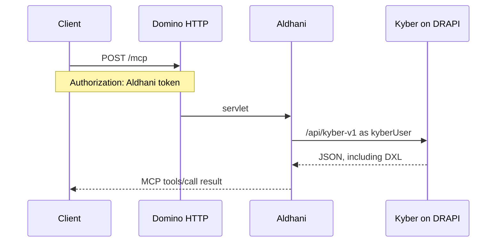

# Aldhani - Infoware MCP server for HCL Domino design

[](https://github.com/infoware-se/aldhani/actions/workflows/ci.yml)
[](https://github.com/infoware-se/aldhani/releases/latest)
[](LICENSE)

An MCP server for an AI agent that creates, reads, updates, and deletes Domino design through Kyber.

Aldhani is an MCP server for HCL Domino design. It runs as an OSGi servlet on the Domino HTTP task and answers MCP at `POST /mcp`. Every design call is a Kyber call on DRAPI. Kyber remains the API that changes design. Writes are off unless `allowWrite` is true.

Version 0.1.17. It is an Infoware Solutions Svenska AB product and is published under [Apache-2.0](LICENSE). The sandbox database is `aldhanitest.nsf`. Kyber only lists a database whose catalog category is `KyberEnabled`.

Design API: [Kyber](https://github.com/infoware-se/kyber). Releases: [jar attachments](https://github.com/infoware-se/aldhani/releases). Contributing: [CONTRIBUTING.md](CONTRIBUTING.md). Security: [SECURITY.md](SECURITY.md).

## Language

Comments, commit messages, and documentation are written in English.

## Purpose

An agent needs to work with Domino design through the products Infoware already runs. The agent speaks MCP. Domino is where that endpoint lives, because Domino is the product being worked on and the servlet installs on another Domino server the same way Kyber's jar does. Kyber on DRAPI is the design API, and it stays the only component that creates or updates a design element.

Aldhani translates MCP into Kyber calls and limits which NSF files the agent may ask about. DRAPI can stay on the server. The agent reaches `/mcp` on the HTTP task. `kyberUser` is the identity Kyber sees, for reads and for writes. Database delete, a full design import, and an ACL replacement are not tools.

## Boundary with Kyber

Kyber is the design API. Aldhani is the MCP product in front of it. Keep that split when adding tools or routes.

| | Kyber | Aldhani |
|--|--|--|
| Runs as | JAR on Domino REST API (DRAPI / KEEP) | OSGi servlet on the Domino HTTP task |
| Speaks | `/api/kyber-v1` (and DRAPI auth) | MCP at `POST /mcp` |
| Changes design in an NSF | Yes — create, update, delete, export, import, validate, compile, binary content, inherit | No — every design mutation is a Kyber call as `kyberUser` |
| Chooses which NSF an agent may touch | Catalog category `KyberEnabled` + Domino ACL | `allowedNsf` allowlist before Kyber is called |
| Chooses which routes an agent may call | Ships the full design surface | Tool list, `allowWrite`, and explicit refusals |
| Own work without Kyber | — | `repo_path` / `repo_status` / `sync_repo` under `repoRoot` (disk only); `debug_kyber` |

Aldhani must not grow a second DXL writer. New Domino design capability belongs in Kyber first; Aldhani wraps it and applies policy. Aldhani backlog is MCP, allowlist, writes policy, repo sync, smoke, and wrapping. Kyber backlog is design routes and round-trip behavior — see [Kyber's Improvements](https://github.com/infoware-se/kyber#improvements).

Refused on purpose in Aldhani (still available in Kyber for other clients): database delete, full design import or replace, ACL replace or delete. Outside both products' design scope: application documents, DQL, running agents as general automation, server console, compact, quota, and user administration.

## How a call moves



Two checks happen on every call.

1. The servlet accepts `Authorization: Aldhani`, `X-Aldhani-Token`, or an access token Aldhani itself signed. The first two are compared with `bearerToken`.
2. The servlet logs in to Kyber with `kyberUser` and `kyberPassword`, then sends Kyber's bearer on the design request.

The allowlist is applied before Kyber is called. A path that contains `..`, starts with `/`, or contains `:` is rejected. When `allowedNsf` has one entry, `nsfPath` may be omitted and that entry is used. When several are listed, omit `nsfPath` only after the MCP session has already used one: the servlet remembers that NSF for later calls on the same `MCP-Session-Id`. A missing `nsfPath` with no session default returns an error that names every allowlisted path. `list_databases` asks Kyber for databases and then keeps only allowlist names. Names on the allowlist that Kyber did not return are listed under `missing`.

## What this version leaves to Kyber

With `allowWrite` false, Aldhani only reads (including `search_design`, `get_design` by `unid`/`noteId`, `list_templates`, `preview_starter`, and `get_content`). With `allowWrite` true, database tools (`create_database`, `create_database_from_template`, `set_db_title`, `set_kyber_enabled`) and design tools (`create_design` with optional `template`, `update_design`, `patch_design`, `copy_design`, `rename_design`, `update_content`, `recompile_lotusscript`, `inherit_design`, `delete_design`, `validate_design`) call the matching Kyber route. Residual notes use type `designnote`. `validate_design` writes nothing. Database delete, a full design import, and replacing the ACL stay in Kyber and are not tools.

A tool result is text. A body over 100 000 characters is returned as JSON with `truncated` and `chars`, plus `name` and `unid` when the payload has them. The DXL is left out, so the result is never cut in the middle of a string. `get_design` and `export_design` take `part`, a zero-based page of 40 000 characters of the raw body. `list_design` and `search_design` take an optional `limit`. Prefer `search_design` or `inventory_design`, then `get_design` for one element.

## Improvements

Kyber is the design API. This section is Aldhani's own backlog: MCP, allowlist, writes policy, repo sync, smoke, and wrapping Kyber helpers that agents still invent from inventory loops. Aldhani only wraps what Kyber exposes. Remaining Kyber-side work is tracked in [Kyber's Improvements](https://github.com/infoware-se/kyber#improvements).

Bearer login. Aldhani already issues an RS256 access token, and `POST /mcp` accepts `Authorization: Bearer` when the token is one it signed. Domino's HTTP task swallows that header and returns the login page until the internet site trusts Aldhani as an OIDC provider and has Bearer authentication enabled. The discovery document Domino reads is `GET /oauth/.well-known/openid-configuration`, and the key is `GET /oauth/jwks`. Until that trust is in place, clients keep using `Authorization: Aldhani`.

Shipped in 0.1.17. Every tool declares `outputSchema`. `debug_kyber` and debug-level logs expose the last Kyber method/path/status without tokens. `repo_status` reports synced trees under `repoRoot`. Inventory includes `skippedElements`. Smoke asserts get-after-put and `validate_design` on a known-good form. `delete_design` refreshes the repo tree when `repoNsf` matches so stale DXL is removed.

Shipped against Kyber 0.26+. Helpers for search/lookup/copy/rename/patch, templates/binary/compile, database title/category/fromTemplate/inherit, typed `designnote` CRUD, `databases.more`, ACL `entries`/`roles` on `get_design` type `acl`, `/named` for parenthesis titles, and per-NSF `writeNsf` grants wrap the matching Kyber routes and Aldhani policy.

Missing design tools (high value). Need new Kyber routes first: `diff_design`, `list_fields` / `list_columns`, and `get_design_summary`. Aldhani will not parse DXL locally for those.

Missing design tools (medium value). `list_agents_schedule`, `import_design_element` (one DXL create-or-replace, not a full NSF import).

Missing design tools (lower value, still worth tracking). Design-note undo or version history, formula-only validate separate from DXL `validate_design`, list private vs shared design, compare inventories across two allowlisted NSFs, and chunked or resumable write for DXL larger than the MCP truncation window.

Repo sync polish. `sync_repo` and post-write/`delete_design` refresh replace a whole NSF tree when `repoNsf` matches. Remaining: optional `repoRoot` relative to the MCP client workspace, and clearer agent guidance when a write races while `repoRoot` is unset.

MCP and agent UX. Prompts exist but many hosts barely surface them. Session default `nsfPath`, `aldhani://types`, inventory resources, progress, completions, richer `outputSchema`, and `debug_kyber` are shipped (see Call the endpoint).

Kyber dependencies. Anything still waiting on new Kyber work stays in [Kyber's Improvements](https://github.com/infoware-se/kyber#improvements).

Keep out of tools. Database delete, full design import or replace, and ACL replace or delete stay unavailable on purpose. Application documents, DQL, running agents, server console, compact, quota, and user administration stay outside this design MCP; another product can cover those.

## Requirements

- Domino HTTP task with the Equinox servlet registry (`javax.servlet` 2.4 or 2.5, the `com.ibm.pvc.servlet` bundle)
- Java 21
- Kyber installed on DRAPI, reachable from the HTTP task
- JDK 21 on the build machine. `build.ps1` uses `C:\Domino\jvm` when that JVM has `java`, and `javac` from `PATH` when the Domino JVM has no compiler

DRAPI's data port can stay unpublished. Aldhani calls it from the same machine. The example configuration uses `https://dantooine.oninfoware.local:8880` and trusts that certificate (`insecureTls`).

## Build

```powershell
.\build.ps1
```

The build compiles the servlet, runs `AldhaniSelfTest` in process, and writes `target\infoware-aldhani-0.1.17.jar`. That jar is the OSGi plugin. `feature.xml` is packed inside it for `install.ps1`. The self-test does not call Domino or Kyber.

`target\` is gitignored.

## Install

The HTTP task loads the feature only when it is listed in `platform.xml`. The applications site on Domino uses the `USER-EXCLUDE` policy, and Equinox reads the feature as a directory, so copying a jar into `plugins` is not enough. `install.ps1` does three things:

- copies the plugin to `plugins\se.infoware.domino.aldhani_0.1.17.jar`
- unpacks `feature.xml` to `features\se.infoware.domino.aldhani.feature_0.1.17\`
- adds the feature under the applications site in `domino\workspace\.config\org.eclipse.update\platform.xml`

Stop HTTP first. On shutdown the HTTP task rewrites `platform.xml` from memory, so an edit made while HTTP is running is lost. `tell http restart` does not reload this configuration.

```text
tell http quit
.\install.ps1 -DataDir <Domino data>
load http
```

`install.ps1` refuses to run when `nhttp` is running and `<Domino data>\notes.ini` exists. Leave the Windows service running. Restart only the HTTP task.

`-Jar` defaults to the single `target\infoware-aldhani-*.jar` from the build.

A new jar is picked up on the next HTTP start. `aldhani.json` is read again when its modification time changes, without an HTTP restart.

## Configuration

Copy `aldhani.json.example` to `<Domino data>\aldhani.json`. `ALDHANI_CONFIG` can point at another file. The example file's `_comment` key is ignored.

| Field | Meaning |
| --- | --- |
| `kyberBaseUrl` | DRAPI data URL, without a trailing slash. |
| `kyberUser` | Domino name Aldhani sends to `POST /api/v1/auth`. |
| `kyberPassword` | Password for that name. |
| `bearerToken` | Token the MCP client must send. |
| `allowedNsf` | NSF paths Kyber may be asked about. At least one. |
| `insecureTls` | Trust DRAPI's certificate and skip hostname checks. Use this for a private certificate on the same server. |
| `allowWrite` | When true, list the write tools (create/update/patch/copy/rename/delete/validate, plus create_database). Missing or false keeps an existing install read-only. |
| `writeNsf` | Optional list of allowlisted NSFs that accept writes when `allowWrite` is true. Omit the key (do not use an empty list) to allow every allowlisted NSF. Use this to keep app NSFs readable while only the sandbox is writable. |
| `repoRoot` | Optional directory. A design write refreshes that NSF here, and `sync_repo` refreshes every NSF in `repoNsf`. |
| `repoNsf` | Optional list of allowlisted NSFs to write under `repoRoot`. Missing means every allowlisted NSF. |
| `publicBaseUrl` | Optional HTTPS origin used in OAuth metadata, with no trailing slash. When it is missing, Aldhani uses the request host. |
| `oauthSubject` | Optional Domino name placed in the access token. When it is missing, `kyberUser` is used. Domino must be able to find that person. |

`aldhani.json`, `aldhani-oauth.pem`, `.env`, and `.cursor/mcp.json` hold passwords, tokens, and the OAuth signing key. They are gitignored. A later save of `aldhani.json` is read on the next call. A save that does not parse leaves the last good configuration in place, including the caller token.

## Call the endpoint

`POST /mcp` with `Content-Type: application/json` and an `Accept` of `application/json`, `text/event-stream`, or `*/*`. `GET` and `DELETE` return 405. A notification, a request with no `id`, returns 202 and an empty body. `initialize` returns `MCP-Session-Id`. Later requests may send it back. The design calls do not require it.

Accepted protocol versions are `2024-11-05`, `2025-03-26`, `2025-06-18`, and `2025-11-25`. Any other version is answered as `2025-11-25`. A later request with an `MCP-Protocol-Version` outside that list returns 400. A request whose `Origin` is present and is neither this host nor a loopback host returns 403.

`initialize` returns server instructions. Methods are `initialize`, `notifications/initialized`, `ping`, `tools/list`, `tools/call`, `resources/list`, `resources/templates/list`, `resources/read`, `completion/complete`, `prompts/list`, `prompts/get`, and `logging/setLevel`. `notifications/cancelled` stops a call that is still running.

A successful tool result that is a JSON object is also returned as `structuredContent`. Tools whose result is a JSON object declare `outputSchema`. `export_design` does not, because its usual result is DXL text.

Resources:

| URI | Content |
| --- | --- |
| `aldhani://types` | Collection and singleton type names (no Kyber call). |
| `aldhani://<nsf>` | That allowlisted database from `list_databases`. |
| `aldhani://<nsf>/inventory` | `inventory_design` for that NSF. |
| `aldhani://<nsf>/<type>` | `list_design` or a singleton `get_design`. |
| `aldhani://<nsf>/<type>/<name>` | One element via `get_design`. |

The NSF path may contain slashes; the longest allowlisted path wins. Templates mirror the same shapes with `{nsfPath}`.

`completion/complete` finishes `type`, `nsfPath` from `allowedNsf`, `fileType`, `match`, and, when `type` is already set, element `name` / `toName` / `newName` from `list_design`, or `template` from `list_templates`.

Prompts are `review_design` and `explain_design`. `create_element` is listed when `allowWrite` is true. Each one tells the agent which tool to call. They do not write by themselves. A `cursor` on `prompts/list` is an error, because the list is not paged.

`logging/setLevel` takes a syslog severity (`debug` through `emergency`). A tool call then emits `notifications/message` at that severity and above. A call that includes `_meta.progressToken` also emits `notifications/progress` (including mid-call updates from `export_design`, `inventory_design`, and `sync_repo`). When `Accept` contains `text/event-stream`, those messages are written on the response as they happen, and the JSON-RPC result is the last event. A client that asks only for `application/json` still receives the result.

A missing or wrong token returns 401. The challenge is `Aldhani`, and also `Bearer` with `resource_metadata` pointing at `/.well-known/oauth-protected-resource/mcp`.

Two ways reach the servlet:

- `Authorization: Aldhani <token>` or `X-Aldhani-Token`, compared with `bearerToken`. This is the direct header. Domino session authentication does not consume it.
- OAuth 2.1 with PKCE. Discovery is under `/oauth`. The authorize page asks for the same `bearerToken`. The access token is an RS256 JWT, valid for 10 minutes, with scope `aldhani` and `Domino.user.all`. Domino's HTTP task only forwards `Authorization: Bearer` when that JWT passes its own OIDC check, so the internet site has to trust this server as an OIDC provider and have Bearer token authentication enabled. Until then, a client that sends Bearer gets Domino's login page. The signing key is `aldhani-oauth.pem` beside `aldhani.json`. It is created on first use and is not part of the jar.

The access token is a Domino bearer for `oauthSubject` (or `kyberUser`) for those 10 minutes. It is not limited to `/mcp`. The refresh token is opaque, lasts 12 hours, and cannot be used against the rest of the server. An authorization code lasts 2 minutes and can be exchanged once.

PKCE `S256` is required. The built-in client id `aldhani` may redirect to loopback or `cursor://`. Any other client registers at `POST /oauth/register` with `redirect_uris`. A redirect must be `https`, loopback, or `cursor://`.

| Path | Role |
| --- | --- |
| `GET /.well-known/oauth-protected-resource` | Resource metadata for the host. |
| `GET /.well-known/oauth-protected-resource/mcp` | Resource metadata for `/mcp`. The 401 challenge points here. |
| `GET /.well-known/oauth-authorization-server/oauth` | Authorization server metadata. |
| `GET /.well-known/openid-configuration/oauth` | The same metadata, for an issuer with a path. |
| `GET /oauth/.well-known/openid-configuration` | The same metadata, appended to the issuer. Domino's OIDC client reads this one. |
| `GET /oauth/jwks` | The RS256 public key. |
| `GET /oauth/authorize` | Asks for `bearerToken`, then redirects with a code. |
| `POST /oauth/token` | Exchanges a code or a refresh token. |
| `POST /oauth/register` | Dynamic client registration. |

Cursor, with the direct header, in `.cursor/mcp.json`:

```json
{
  "mcpServers": {
    "Aldhani": {
      "type": "http",
      "url": "https://dantooine.oninfoware.local/mcp",
      "placement": "client",
      "headers": {
        "Authorization": "Aldhani <token>"
      }
    }
  }
}
```

Replace the host. The header value is the same string as `bearerToken`.

## Tools

`tools/call` returns the Kyber body as a text content block. A Kyber error or a rejected argument sets `isError` to true. An unknown tool name does the same. An unknown MCP method is a JSON-RPC error `-32601`.

### list_databases

Kyber databases of the given `fileType` that are also on `allowedNsf`. The default `fileType` is `database`. Also accepted: `notes_database`, `template`, `replica_candidate`, `template_candidate`, and the Notes file-type numbers Kyber accepts (`1247`, `1248`, `1245`, `1246`).

The result has `allowedNsf`, `databases` (`nsfPath`, `replicaId`, `dbTitle`), and `missing`. When Kyber signals more pages, the result also has `more` set to true.

### list_design

Lists one collection in an allowed NSF. `type` is required. Singular and plural names both work (`form` and `forms`). `limit` keeps the first rows. When the collection is longer, the result has `truncated`, `returned`, and `total`.

| `type` | What Kyber lists |
| --- | --- |
| `forms` | Forms |
| `subforms` | Subforms |
| `pages` | Pages |
| `views` | Views |
| `folders` | Folders |
| `framesets` | Framesets |
| `outlines` | Outlines |
| `navigators` | Navigators |
| `agents` | Agents |
| `scriptlibraries` | Script libraries |
| `sharedfields` | Shared fields |
| `sharedcolumns` | Shared columns |
| `sharedactions` | Shared actions |
| `images` | Image resources |
| `fileresources` | File resources |
| `stylesheets` | Style sheets |
| `themes` | Themes |
| `dataconnections` | Data connections |
| `applets` | Applets |
| `javasources` | Java sources |
| `jars` | JARs |
| `webservices` | Web service providers |
| `webserviceconsumers` | Web service consumers |
| `compositeapplications` | Composite applications |
| `compositecomponents` | Composite components |
| `customcontrols` | Custom controls |
| `wiringproperties` | Wiring properties |
| `webcontent` | WebContent files |
| `xpages` | XPages |
| `xpagesresources` | XPages project files |
| `designnotes` | Residual named design notes |

A database note is not a collection. Read it with `get_design`.

### get_design

Returns one Kyber JSON object, including its DXL.

- For a collection, `name` is the element name. XPages resource paths may contain a slash. `part` reads a large body in pages of raw text. The first page is `0`.
- For a database note, omit `name`. `type` is one of `about`, `acl`, `applicationproperties`, `databasescript`, `dbicon`, `using`, `xspproperties`.
- Or pass `unid` or `noteId` (not both, and not with `type`/`name`) to call Kyber `GET /lookup`. `includeDxl` defaults to true.

### export_design

Exports the design of one allowed NSF as DXL. The body is large. Prefer `inventory_design`, then `get_design`, when the DXL bodies are not needed. `part` reads the raw export in pages.

### inventory_design

Lists every design element in one allowed NSF without DXL. Each row has `type`, `name` when present, `noteId`, and `unid`. When Kyber reports skipped notes, the response includes `skipped` (count) and `skippedElements` (`type`, optional `name`, `message`). Prefer this before `get_design`.

### search_design

Searches design names and optionally DXL via Kyber `GET /search`. `q` is required. Optional `types` (comma-separated or a string list), `match` (`name`, `dxl`, or `both`), and `limit` (at most 200).

### list_templates

Lists starter names for one design type via Kyber `GET /templates`. Optional `kind` for agents, script libraries, and Java sources. `nsfPath` is usually omitted (Kyber uses KeepConfig / `kyber.nsf`).

### preview_starter

Resolves empty-create starter DXL via `POST /defaults/preview` without writing. Optional `template`, `name`, and `kind`.

### get_content

Returns binary content as `contentBase64` via `GET /content`. `type` is `image`, `fileresource`, `jar`, or `dbicon`. `name` is required except for `dbicon`. `part` pages a large body the same way as `get_design`.

### repo_path

Returns the Package Explorer path for a design file. It does not call Kyber. Omit `type` to list every folder. `nsfPath` and `replicaId` are set together and produce `domino/<nsfPath>-<replicaId>`. `noteId` makes the file `<name>-<noteId>.dxl`. Singular and plural type names both work. Java sources keep their package under `Code/Java`. An XPages resource under `WEB-INF` is `WebContent/WEB-INF`.

### repo_status

Reads `manifest.json` trees under `repoRoot` and returns `nsfPath`, `replicaId`, `elementCount`, `root`, and `syncedAt`. Does not call Kyber. Fails when `repoRoot` is unset.

### sync_repo

Reads `GET /export` and writes every element under `repoRoot`, replacing that NSF's folder. The database icon is `Resources/Images/$DBIcon-<noteId>.dxl`. Omit `nsfPath` to refresh every NSF in `repoNsf`. Design writes and deletes that change an NSF do the same refresh when that NSF is in `repoNsf`, so stale DXL is removed. `validate_design` does not. Fails when `repoRoot` is unset.

### debug_kyber

Returns `kyberBaseUrl` and the last Kyber HTTP `method`, `path` (query stripped), `status`, and `ok`. Never includes tokens, passwords, or bodies.

### create_database, create_database_from_template, set_db_title, set_kyber_enabled, create_design, update_design, patch_design, copy_design, rename_design, update_content, recompile_lotusscript, inherit_design, delete_design, validate_design

Listed only when `allowWrite` is true. They call Kyber as `kyberUser`.

- `create_database` posts to `POST /database`. `nsfPath` must be on `allowedNsf`. `dbTitle` sets the title. Kyber sets the category `KyberEnabled` and gives the caller Manager. An existing file is left unchanged. Database delete is not a tool.
- `create_database_from_template` posts to `POST /database/fromTemplate`. Target `nsfPath` must be allowlisted. `templateNsfPath` is path-safe but need not be allowlisted. Optional `encryption` (`none`, `simple`, `medium`, `strong`, `aes128`, `aes256`).
- `set_db_title` puts `dbTitle` via `PUT /database`.
- `set_kyber_enabled` puts `enabled` via `PUT /database/category`.
- `create_design` posts to the collection (including `designnotes`). `name` is required. Omit `dxl` to copy Kyber's starter. `template` selects a named starter from `list_templates` (not with `dxl`). Agents, script libraries, and Java sources take `kind`. `about`, `using`, `databasescript`, and `xspproperties` can be created. `acl`, `applicationproperties`, and `dbicon` cannot.
- `update_design` puts DXL onto an existing element or database note. `acl` cannot be replaced. `applicationproperties` and `dbicon` can.
- `patch_design` patches `comment` and/or `alias` via `PATCH /patch` without replacing the DXL.
- `copy_design` posts to `POST /copy`. `toNsfPath` may be another allowlisted NSF.
- `rename_design` posts to `POST /rename`.
- `update_content` puts `contentBase64` via `PUT /content` for `image`, `fileresource`, `jar`, or `dbicon`. Optional `contentType` (for example `image/png`).
- `recompile_lotusscript` posts to `POST /compile`.
- `inherit_design` posts to `POST /database/inherit`. Optional `templateServer`.
- `delete_design` deletes a named element, or `about`, `using`, `databasescript`, or `xspproperties`. `acl`, `applicationproperties`, and `dbicon` cannot be deleted.
- `validate_design` posts `{elements:[{type, name, dxl, delete}]}` to `POST /validate` and writes nothing. `dxl` is required unless `delete` is true.

Read tools are marked read-only. `delete_design` is marked destructive.

`notifications/cancelled` with the JSON-RPC `requestId` stops a design call that has not finished. The stopped call returns no result. A cancellation that arrives after the result is ignored.

## Smoke

`smoke.ps1` calls a running servlet. It checks anonymous and wrong-token rejection, the `Aldhani` challenge, `GET` and `DELETE` 405, ping, an unknown method, instructions, the prompts and logging capabilities, `review_design`, type completion, an allowlisted resource, `outputSchema` on every tool, and the read-only and destructive hints. It reads the OAuth discovery document. It reads every collection and every database note in `aldhanitest.nsf`, including `SmokeForm`, `SmokeView`, the `SmokeAgent*` agents, and `SmokeXPage.xsp`. Each sampled element has a UNID on the list and on the get. `limit` on agents keeps the first row. `type=defaults` is refused. The export is either full DXL or a JSON object with `truncated` and `chars` and no DXL. `kybertest.nsf` is refused. When the write tools are listed, the run creates `AldhaniSmokeProbe`, asserts get-after-put, validates a known-good form DXL, refuses an ACL replace, validates a broken form without writing, checks `debug_kyber`, and deletes the probe. When they are not listed, calling them is an error.

```powershell
.\smoke.ps1
.\smoke.ps1 -Url https://dantooine.oninfoware.local/mcp -Config C:\Domino\Data\aldhani.json
```

The script reads `bearerToken` from the config file and does not print it. It is not part of `build.ps1`.

## Layout

| Path | Role |
| --- | --- |
| `src/main/java/se/infoware/domino/aldhani/` | Servlet, MCP protocol, Kyber client, design tools |
| `src/main/resources/plugin.xml` | Equinox aliases for `/mcp` and the OAuth paths |
| `src/main/resources/feature.xml` | Feature installed into the applications site |
| `src/test/java/.../AldhaniSelfTest.java` | In-process checks run by `build.ps1` |
| `src/test/java/.../AldhaniSmoke.java` | Live checks run by `smoke.ps1` |
| `build.ps1` | Compile, self-test, and jar |
| `install.ps1` | Place the jar, feature, and `platform.xml` entry |
| `aldhani.json.example` | Configuration template |
| `LICENSE` | Apache License, Version 2.0 |

## License

Aldhani is open-source software licensed under the Apache License, Version 2.0. Copyright 2026 Infoware Solutions Svenska AB.

[Apache-2.0](LICENSE). Report vulnerabilities in [SECURITY.md](SECURITY.md), not in public issues.
